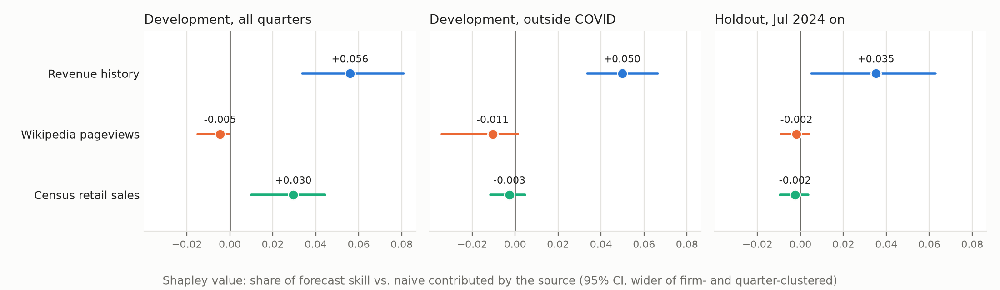

# What Is Data Worth?

[](https://github.com/nirzareee/altdata-nowcast/actions/workflows/tests.yml)

**Measuring how much each alternative data source adds to forecasts of company revenue.**

Funds and companies buy external data (web traffic, search trends, app usage, job postings) to see business performance before it is reported. Most of these sources overlap, and it is rarely measured what any one of them adds on top of the others. This project builds a leakage-free forecasting pipeline and uses it to put a number, with uncertainty, on the value of each source.

The test case: nowcast quarterly revenue growth for US consumer companies a week after each quarter ends, weeks before the company reports it.

## How it works

1. **Collect** revenue from SEC filings and daily signals from public sources.
2. **Align in time.** Every value carries the date it became public. A forecast made on date `t` sees only data public before `t`.
3. **Forecast** with walk-forward models: for each quarter, train only on quarters already reported, then predict.
4. **Value each source** with Shapley values: a source's average contribution to forecast skill across every combination of the other sources. Overlapping sources share credit instead of each claiming it.

## Results

99 S&P 500 consumer firms, 2016–2026, about 3,700 firm-quarters. Models were developed on nowcasts up to June 2024; nowcasts from July 2024 on (882 firm-quarters) were held out and scored once.



| Source | Development, all quarters | Development, outside COVID | Holdout | Verdict |
| --- | --- | --- | --- | --- |
| Revenue history | +0.056 [+0.034, +0.081] | +0.050 [+0.034, +0.066] | +0.035 [+0.005, +0.063] | Helps, including out of sample |
| Census retail sales | +0.030 [+0.010, +0.044] | −0.003 [−0.012, +0.005] | −0.002 [−0.009, +0.004] | Helps only in a macro shock |
| Wikipedia pageviews | −0.005 [−0.015, −0.000] | −0.011 [−0.034, +0.001] | −0.002 [−0.009, +0.004] | No value; slightly harmful in development |

Shapley value of each source, with 95% intervals (wider of firm- and quarter-clustered bootstrap). Full tables: [results/summary.md](results/summary.md).

1. **Firm-level revenue history is the only source with lasting value.** On the holdout it beats the naive forecast by 3% (Diebold-Mariano p = 0.011) and calls the direction of change in growth 61% of the time.
2. **Macro category data is a shock detector.** Census retail sales by category carried real value through COVID, when whole categories moved together, and none in normal quarters, including the holdout.
3. **Free attention data adds nothing.** Wikipedia pageviews add no skill in any sector, business model or period; where significant, they hurt, as models fit noise.
4. **Publication timing is the leak that matters.** Letting a backtest use Census months not yet released by the forecast date doubles the measured value of retail data (+0.030 → +0.059); using revised instead of as-published figures changes nothing. See [results/revision_bias.md](results/revision_bias.md).
5. **Method matters more than models.** Point-in-time data, robust loss and anchoring on the naive forecast moved results more than any model choice did; see the development log below.

## Development log

### Step 4 results: are the values real? (95% CIs, wider of firm- and quarter-clustered bootstrap)

| Source | All quarters | Outside COVID | Verdict |
| --- | --- | --- | --- |
| Revenue history | +0.056 [+0.034, +0.081] | +0.050 [+0.034, +0.066] | Helps in every setting; beats naive (Diebold-Mariano p = 0.005) |
| Census retail sales | +0.030 [+0.010, +0.044] | −0.003 [−0.012, +0.005] | Helps only through COVID |
| Wikipedia pageviews | −0.005 [−0.015, −0.000] | −0.011 [−0.034, +0.001] | Slightly hurts: adds noise the model partly fits |

All sources together beat naive with p = 0.025.

### Step 3 results: Census retail sales (ALFRED vintages), 99 firms

Shapley value of each source, measured on all quarters and outside COVID (Apr 2020 – Dec 2022):

| Group | Revenue history | Wikipedia | Retail sales | Retail sales, ex-COVID |
| --- | --- | --- | --- | --- |
| All | +0.056 | −0.005 | **+0.030** | −0.003 |
| Consumer Discretionary | +0.042 | −0.002 | +0.029 | −0.004 |
| Consumer Staples | +0.080 | −0.002 | +0.010 | +0.003 |
| Communication Services | +0.058 | −0.006 | −0.020 | −0.007 |

- **Category retail sales are a shock detector, not a steady signal.** All of their value comes from COVID, when whole categories moved together; in normal quarters they add nothing.
- **The value tracks the economic link.** It is highest for retailers and restaurants (direct category match) and negative for Communication Services (mapped to total retail, no real link).
- **Revenue history stays the most valuable source**, +0.050 outside COVID.

### Step 2 results (99 S&P 500 consumer firms, Huber model, log growth)

| Group | Firms | n | Revenue history: Shapley value | Wikipedia: Shapley value |
| --- | --- | --- | --- | --- |
| All | 99 | 2,809 | +0.060 | −0.003 |
| Consumer Staples | 33 | 893 | +0.083 | −0.002 |
| Consumer Discretionary | 47 | 1,357 | +0.051 | 0.000 |
| Communication Services | 19 | 366 | +0.048 | −0.001 |

- **The pilot result replicates at 4× the scale.** Revenue history beats the naive forecast by 6% (5% outside COVID) and calls the direction of change 63% of the time.
- **Wikipedia pageviews add no value in any sector.** With 90% feature coverage across 99 firms, this is a robust negative result.
- **Past growth is most informative for consumer staples**, whose growth is steadiest.

### Pilot results (27 firms, Huber model, percent growth, COVID window to Dec 2021)

| Firms | Revenue history: skill ex-COVID | Wikipedia: Shapley value | n |
| --- | --- | --- | --- |
| All | +0.062 | −0.001 | 609 |
| Digital (12) | +0.098 | −0.004 | 160 |
| Physical (15) | +0.049 | +0.001 | 339 |

- **Wikipedia pageviews add no forecasting value**, pooled or split by business model. Per-firm correlations with revenue growth reach 0.5–0.6 for Airbnb, Lyft, Etsy and Uber, but that co-movement doesn't survive into out-of-sample forecasts.
- **Revenue history beats the naive forecast by ~5–10%** outside COVID and gets the direction of change right ~62% of the time.

### What the pilot taught about method

- **COVID dominates raw error.** Errors in 2020–21 are 4–6× other years; results are reported with and without those quarters.
- **Predicting growth from scratch underperformed naive.** Models now predict the change from last quarter's growth.
- **Squared-error models let COVID set the rules.** Ridge trained on the 2020–21 crash-and-rebound over-corrected calm quarters (skill −0.34 outside COVID). Huber loss and clipping fixed it; excluding COVID from training made little further difference.

## Setup

```bash
python3 -m venv .venv && source .venv/bin/activate
pip install -e ".[dev]"      # installs the `nowcast` command
export NOWCAST_USER_AGENT="Your Name you@email.com"   # required by SEC and Wikimedia
export FRED_API_KEY="..."                              # free: fred.stlouisfed.org > My Account > API Keys
pytest -q
```

## Usage

```bash
python -m nowcast.cli universe       # firm list        -> config/universe_sp500.csv
python -m nowcast.cli targets        # SEC revenue      -> data/processed/revenue_quarterly.parquet
python -m nowcast.cli pageviews      # Wikipedia views  -> data/processed/pageviews_daily.parquet
python -m nowcast.cli releases       # earnings press releases (8-K Item 2.02) -> data/raw/releases/
python -m nowcast.cli retail         # Census retail sales, every vintage -> data/processed/retail_vintages.parquet
python -m nowcast.cli panel          # features         -> data/processed/panel.parquet
python -m nowcast.cli evaluate       # forecast skill per source combination
python -m nowcast.cli value          # Shapley value of each source
python -m nowcast.cli value --by sector                       # ...overall and within each sector
python -m nowcast.cli value --ci --metric skill_ex_covid       # ...with 95% confidence intervals
python -m nowcast.cli report         # final tables + chart -> results/ (scores the holdout; runs once)
python -m nowcast.cli revision-bias  # retail value with real-time vs revised Census data -> results/revision_bias.md
python -m nowcast.cli evaluate --where "sector=Consumer Staples"
```

**Universe rule:** every S&P 500 member in Consumer Discretionary, Consumer Staples or Communication Services (103 firms). CIK and Wikipedia article come from the constituents table, so nothing is hand-picked. The 27-firm pilot list is kept in `config/universe.csv` (`--universe config/universe.csv`).

`python -m nowcast.cli panel --synthetic` builds simulated firms with a planted signal; the pipeline should find it.

The holdout (nowcasts from 2024-07-01) is scored once, by `report`. It writes `results/HOLDOUT_SCORED`, and a second run is refused without `--force`, so the holdout can't drift into a tuning set.

Models: `--model huber` (default, robust linear), `ridge`, `gbm`. `--train-covid` includes Apr 2020–Dec 2022 in training, for comparison.

### Reading `evaluate`

| Column | Meaning |
| --- | --- |
| `skill` | 1 − MAE / naive MAE. Naive = growth stays at the last reported rate. Above 0 beats naive |
| `skill_ex_covid` | Same, excluding quarters ending Apr 2020 – Dec 2022 (2022 is compared against COVID-year revenue) |
| `accel_hit_rate` | How often the forecast gets the direction of change in growth right |
| `dm_t`, `dm_p` | Diebold-Mariano test against naive: t-statistic (positive = better) and p-value |
| `(mean)` row | No data: naive plus the average historical change |

## Design decisions

| Decision | Why |
| --- | --- |
| Keep first-reported revenue, not restated | Restatements were not known at forecast time |
| Derive Q4 as fiscal year minus Q1–Q3 | Q4 is only reported inside the 10-K |
| Target year-over-year log growth, ln(revenue / year-ago revenue) | Comparable across firm sizes; removes seasonality; stays bounded when the year-ago base is near zero (cruise lines, casinos in 2021) |
| Predict change from last growth | Small, noisy panel; anchoring on naive avoids fitting noise |
| Don't train on COVID quarters; Huber loss; clip at ±100 pts | One extreme regime shouldn't set the rules for every other quarter |
| Growth features only, no levels | Raw pageviews are not comparable across firms |
| Study starts 2016 | Pageviews begin July 2015; every quarter needs a year-ago window |
| Census retail sales taken from ALFRED vintages | Retail sales are revised for years; using today's numbers would leak revisions. Each feature uses only figures published by the nowcast date, which is usually 2 of the quarter's 3 months |
| Firms mapped to Census categories by GICS sub-industry (`nowcast/retail.py`) | A fixed rule, auditable in `data/processed/retail_map.csv`; unmatched firms use total retail and food services |
| Confidence intervals resample forecasts, clustered by firm and separately by quarter | Errors are correlated within a firm and within a quarter (common shocks); a source counts as valuable only if both intervals exclude zero |
| Diebold-Mariano on quarterly mean loss differentials, Newey-West SE (4 lags) | Collapsing to one value per quarter handles cross-firm correlation; Newey-West handles correlation across nearby quarters |
| Exact Shapley over sources | 2ⁿ model runs is affordable for up to ~10 sources |

`tests/test_pipeline.py` checks the time alignment directly: it changes every value published after a cutoff and asserts earlier features don't move.

## Roadmap

- [x] **Step 1.** SEC revenue, Wikipedia pageviews, walk-forward models, Shapley valuation
- [x] **Step 2.** Expand to S&P 500 consumer sectors (103 firms), Wikipedia mapping taken from the constituents table
- [x] **Step 3.** Census advance retail sales by category, point-in-time via ALFRED (replaces Google Trends: `pytrends` was archived in 2025 and the official API is invite-only)
- [x] **Step 4.** Uncertainty: bootstrap confidence intervals on source values; Diebold-Mariano tests against naive
- [x] **Step 5.** Final run on the untouched 2024–26 holdout; results charts
- [x] Revision bias: how much revised macro data inflates measured source value
- [ ] LLM-extracted guidance from 8-K earnings releases
- [ ] Event study against analyst consensus (WRDS)
- [ ] Interactive results dashboard
- [ ] LLM entity resolution (dropped from the core plan: Wikipedia showed no value even with hand-verified pages)
- [ ] Google Trends, if official API access is granted
- [ ] Job postings, Reddit/news mentions, earnings-call guidance
- [ ] Hierarchical Bayesian model; conformal prediction intervals
- [ ] Bootstrap confidence intervals on source values; value decay over time; value by sector
- [ ] Comparison with analyst consensus; earnings-announcement event study

## Known issues

- The universe uses today's S&P 500 members, so firms that shrank and left the index are missing (survivorship bias). Revenue forecasts are less exposed to this than return studies, but the event study in a later step will need historical membership.
- When several revenue tags cover one period, the largest is kept. Audit the `tag` column for firms that switched around 2018 (ASC 606).
- Wikipedia titles in `config/universe.csv` are hand-picked. Renamed pages lose history; redirects count only direct hits.
- 27 firms is a pilot; conclusions need the full universe.
